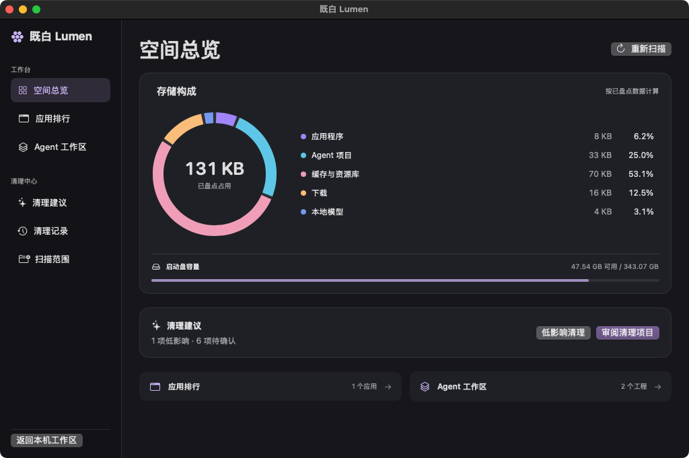

# 既白 Lumen

**Agent 完工，既白收尾。**

*Agents build. Lumen tidies up.*

面向 macOS 的本地磁盘清理器与 Agent 工作区管理工具。既白把应用占用、项目归属、共享素材和清理依据放在一起，帮你判断清掉一个文件会影响什么。[下载 Apple Silicon 开发预览版](https://github.com/Moosphan/lumen/releases/tag/v0.1.0-dev.1)



## 安全体验

需要 macOS 13+、Swift 5.10+ 的 Xcode 工具链和可用的 `/usr/bin/python3`（3.9+）。引擎使用标准库，无需 pip、API 密钥或账号。

```bash
git clone https://github.com/Moosphan/lumen.git
cd lumen
/usr/bin/python3 scripts/package.py
open dist/Lumen.app
```

首次启动从空工作区开始。选择 **创建演练样本**，可看到两个 Agent 共用一个视频工程、被两个工程引用的配乐，以及可处理的日志。演练的设置、隔离区和废纸篓独立于正式工作区。在演练中试一次「隔离 → 恢复」，再点击「返回本机工作区」。正式使用时，从「扫描范围」明确选择下载目录、工程目录、应用安装目录或 Library 子目录。应用不会自动申请管理员权限。

## 可以做什么

| 入口 | 功能 |
| --- | --- |
| 空间总览与应用排行 | 快速/深度盘点、按应用独占量或可低影响清理量排序、核对可处理项 |
| Agent 工作区 | Claude Code/Codex 目录发现、任务输入输出、共享工程与素材、增长与预算提醒 |
| 清理建议 | 筛选大文件、旧下载、重复件、卸载残留；Finder 定位和 Quick Look；用户保留或排除目录 |
| 文件与应用处置 | 低影响直接清理、可恢复隔离、同卷废纸篓、受支持应用的卸载；逐项预演和执行前复核 |
| 清理记录 | 查看成功与跳过的路径、恢复批次、同名旁置恢复、清空及核对空间变化 |

**让 Agent 完工后自己收尾。** 在「Agent 工作区」登记进行中的任务，将原始素材填入「输入」、交付件填入「正式输出」、可舍弃的中间文件填入「临时产物」。在「扫描范围」启用「结束任务时隔离已登记的临时产物」。手动结束任务，或给 Claude Code 任务填写会话 ID 并接入 SessionEnd 后，既白会复核文件并隔离仍符合条件的临时产物。原项目需要某份文件时，可以从清理记录恢复。隔离占用在确认清空后才释放。[Claude 接入与收尾时序](docs/技术方案.md#6-可选的-agent-事件接入)

**规则覆盖。** 低影响操作依赖具体应用版本及文件用途。当前包含 VS Code 1.95.3 的过期会话日志规则；样本应用规则限于既白创建的演练目录。模型按版本和共享 blob 盘点保护，重建成本未知的项目资产进入人工审阅。第三方应用包的可恢复卸载限明确适配且通过身份与占用检查的版本。开发包使用 ad-hoc 签名，正式 Developer ID 分发与公证见 [#10](https://github.com/Moosphan/lumen/issues/10)。

## 测试

```bash
./scripts/test-isolated.sh
./tests/native/smoke.sh
```

第一条命令在私有临时目录生成文件、应用包、工程和多份副本，使用 macOS 沙箱禁止测试进程联网及向测试目录外写入。第二条运行 Swift 客户端到真实 Python 引擎的隔离冒烟测试。两个脚本均自行回收临时夹具。[验证范围与结果](docs/验证报告.md)

## 技术与任务

- [技术分层、扫描与处置时序、状态机、协议和发布验收](docs/技术方案.md)
- [GitHub 任务单、依赖和验收条件](docs/任务索引.md)
- [产品需求](产品需求文档.md) · [完整功能分层图](功能清单与分层功能图.md) · [竞品调研](竞品调研.md)
- [交互设计原型](设计稿/index.html) 使用演示数据；原生程序位于 `Sources/Lumen`，真实文件引擎位于 `engine/lumen`。
