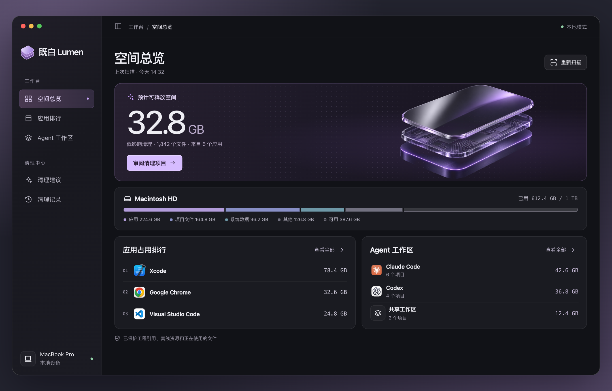

# 既白 Lumen

**Agent 完工，既白收尾。**

为使用本地 Agent 制作软件与视频的 Mac 用户提供磁盘盘点、空间归属、清理预演和可恢复的项目隔离。仓库包含产品需求、交互设计、原生客户端和本地引擎。

- [产品需求与验收标准](产品需求文档.md)
- [功能分层与依赖](功能清单与分层功能图.md)
- [交互原型](设计稿/index.html)
- [开发任务](https://github.com/Moosphan/lumen/issues)
