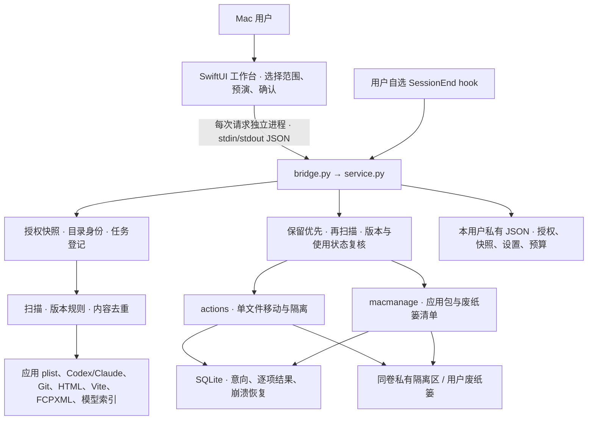
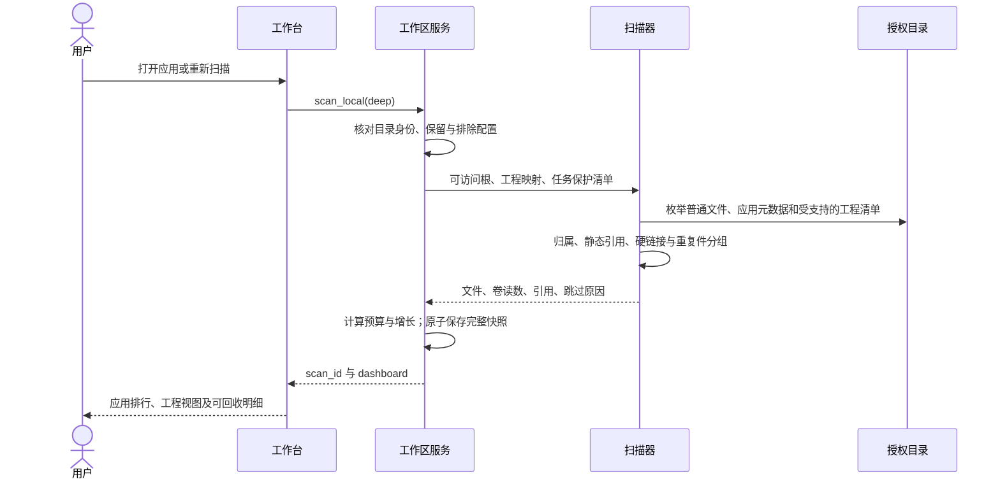
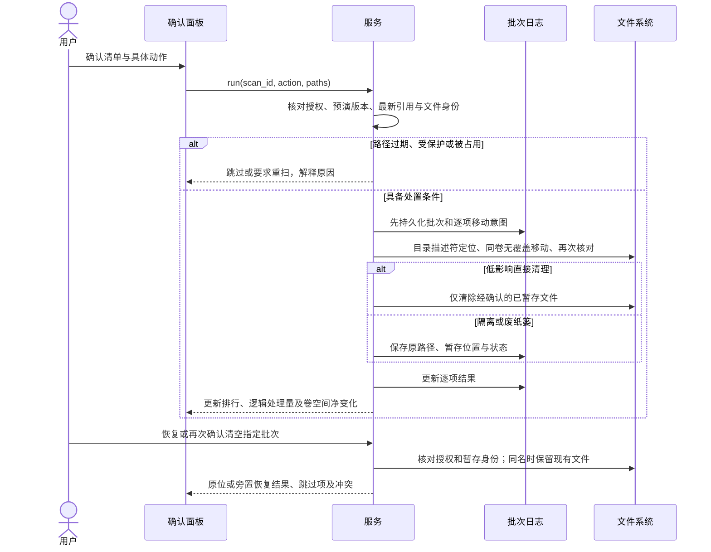
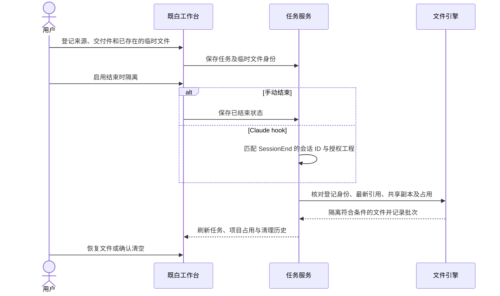

# 既白 Lumen 技术方案

目标平台为 macOS 13 及以上。产品范围与用例以[产品需求](../产品需求文档.md)为准，交付与差距追踪见[任务索引](任务索引.md)和[验证报告](验证报告.md)。

## 1. 架构和信任边界

桌面工作台以 SwiftUI/AppKit 实现，使用系统 Python 3 标准库运行本地文件引擎。选择这两层，是为了复用系统文件选择、Finder 和 Quick Look，同时把目录识别和可恢复操作放入能在临时文件系统独立测试的模块。面向开发者的构建要求安装 Xcode 或对应命令行工具。当前分发包为 ad-hoc 签名的本地开发版本。



界面仅提交路径、动作与当前扫描标识。服务从自己的快照取得身份和处置结论。启动自动盘点标准应用位置、常见缓存、下载和可读取的本机 Agent 项目，应用包本体按分配字节汇总。自动发现的工程以盘点为主，用户可从扫描范围将它加入审阅。下载、用户缓存、日志及 DerivedData 可直接进入人工审阅。授权根绑定设备号和 inode。演练使用独立状态目录、系统临时目录中的伪工作区及专属废纸篓。产品无需网络服务、管理员 helper 或常驻系统扩展。

## 2. 扫描与空间核算



- 快速模式优先盘点。深度模式补查应用容器、开发工具路径、模型与支持数据，并按大小分桶后流式计算内容哈希。后续盘点重用未变更文件的哈希，仍遍历目录以发现删除、权限变化及新增引用。
- 文件身份包括设备号、inode、大小和时间戳。硬链接按底层对象计量；同内容的独立副本按各自占用统计。逻辑字节、块分配量和卷可用空间是不同指标，APFS 克隆和快照会影响实际回收量。
- Claude Code 和 Codex 仅从受支持的记录提取 cwd，未覆盖的工程列为缺口。工程内与跨工程引用、Git 跟踪、任务输入和交付物构成保留依据。HTML 仅覆盖静态路径。Vite manifest 识别构建输出，FCPXML 识别本地媒体引用，Hugging Face refs/snapshots 用于保护共享 blob。
- 应用按 bundle ID、安装路径及可核对的 Library 子目录归属。当前真实低影响规则匹配特定 VS Code 版本和日志保留语义。未知版本仍可盘点。演练规则限服务登记且身份未变化的样本根。
- 任务清单由用户明确登记。重复的 SessionEnd 用稳定 ID 去重；先前登记的源素材与交付物一直受保护。自动规则需显式启用，并限于结束任务范围内符合规则的路径。可从源码运行本仓库的 hook，无安装时修改第三方配置的步骤。

## 3. 写操作、恢复和一致性



状态流转为 pending → moving → quarantined/trashed → restoring/restored 或 purging/purged。直接移除先暂存，再从 cleaning 进入 cleaned。服务锁串行化预演与工作区状态更新；执行器另用文件锁和 SQLite 意向日志，让中断后可通过原路径和暂存路径核对状态。应用卸载校验受支持包身份、目录清单、使用状态与显式保护；残留需要单独审阅。清空废纸篓只处理用户选中的顶层条目及预演中核对的后代。遇离线、同名冲突或目录变更时保留可恢复记录。

## 4. 接口与数据

每个请求返回 `{"ok": true, "data": ...}` 或 `{"ok": false, "error": ...}`。使用标准输入传参，避免 shell 展开路径。

| 请求 | 输入 | 结果或副作用 |
| --- | --- | --- |
| status / fixture | 无 | 读取上次快照 / 创建合成目录 |
| scan_local / scan | deep；手动范围可附 roots 和 renew_roots | 盘点默认及手动位置、生成新 scan_id；重扫仅替换完整结果 |
| scan_app | 已索引的应用路径 | 扩展该应用的沙盒缓存和临时目录，更新文件分类与 scan_id |
| size_tree | 当前目录，可省略为个人或演练目录 | 只读统计当前层级和各子树的分配占用，按大小排序 |
| settings / task | 保留、排除、预算、延后、授权、工程映射、任务输入输出 | 原子更新配置并重新评估 |
| session_end | 明确接入的 Claude 事件 | 登记收尾，显式启用的规则可触发作用域内清理 |
| run | scan_id、action、paths | 批次记录及逐项结果 |
| uninstall | scan_id、应用路径 | 校验安装快照后可恢复隔离 |
| trash_list / empty_trash | 读取已单独授权的废纸篓；确认时带 scan_id 和 paths | 逐卷预览或删除所选条目 |
| restore / purge | batch_id，恢复可选 beside | 按记录复核，恢复或清空 |

默认状态在用户的 `Library/Application Support/org.lumen.cleaner`，目录权限 0700。workspace.json 存放授权、规则、任务、最近一次索引和哈希缓存；actions/journal.sqlite3 存放操作批次。完整会话消息不写入索引。撤回范围后刷新索引，历史记录仍可说明以前执行过哪些操作。关停应用不触发自动清理。

## 5. 性能、安全与发布验收

- 目录遍历、索引和总表排序随文件数增长；深度哈希耗时取决于相同大小候选的读取总量。当前快照为内存对象和原子 JSON，超大文件树的峰值内存与界面响应是发布前需实测的限制。
- 文件写入采用不跟随链接的目录描述符和身份检查。打开句柄与进程检查提供执行前证据；其他进程仍可能在检查后访问文件。保留、撤回、已知引用与不完整授权均影响最终结果。
- 交付门槛依次为隔离引擎回归、原生客户端与引擎联调、发行构建和签名校验，再到干净 VM 上的真实应用版本、登录态、离线资料、多卷弹出和性能验证。最后一阶段的证据与合成夹具分开记录。Developer ID 签名、公证和持续适配真实版本需要单独的发布凭据和验证流程。
- [Claude SessionEnd](https://code.claude.com/docs/en/hooks#sessionend)、[Vite manifest](https://vite.dev/guide/backend-integration)、[Hugging Face 缓存结构](https://huggingface.co/docs/huggingface_hub/guides/manage-cache)、[VS Code 固定版本保留逻辑](https://github.com/microsoft/vscode/blob/1.95.3/src/vs/code/electron-utility/sharedProcess/contrib/logsDataCleaner.ts#L27-L40) 是适配器的依据。

## 6. 可选的 Agent 事件接入

安装到预期位置后，可由用户在 Claude Code 的 SessionEnd command hook 配置以下命令。路径需与实际安装位置一致。该命令读取标准输入上的单条事件，只接受已授权工程的 cwd；没有授权时返回错误。示例配置不会随构建自动写入 Claude 的设置。

```json
{
  "hooks": {
    "SessionEnd": [{
      "hooks": [{
        "type": "command",
        "command": "/usr/bin/python3 -I -B '/Applications/Lumen.app/Contents/Resources/engine/session_end.py'"
      }]
    }]
  }
}
```

「Agent 工作区」支持手动登记各类 Agent 任务。需要关联 Claude hook 时，在新任务中填写 `Claude Code` 和真实会话 ID。其他 Agent 可以手动结束任务。



自动隔离仅面向在任务进行时明确登记、位于项目内的临时文件。登记后发生替换、修改、授权变化或新增引用时，服务重新判断资格。来源、正式交付件、其他进行中任务的素材和模型受到保护。用户可从清理记录恢复。此规则和 VS Code 版本限定的日志直接移除规则可以分别启停。位于工程外的 Library 缓存沿用常规审阅流程。
