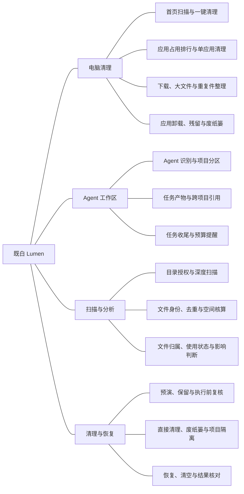
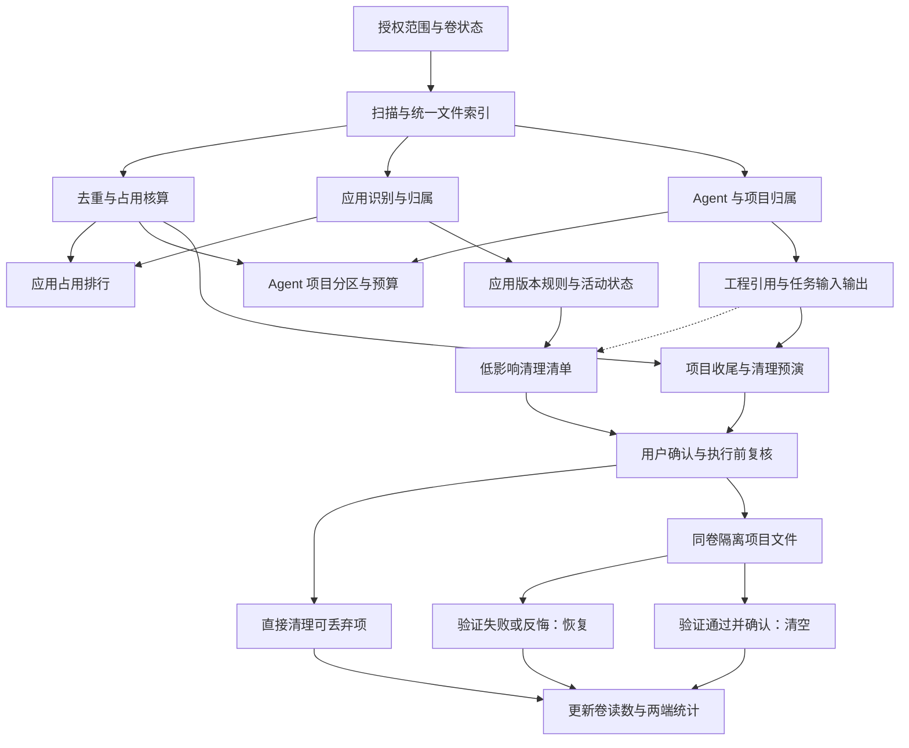

# 既白 Lumen 功能清单与分层功能图

依据[产品需求文档 v0.5](./产品需求文档.md)。面向 macOS，提供「电脑清理」和「Agent 工作区」两个入口。下文 P0 为首版需求，P1 为已规划扩展，候选项需经用户验证。图中功能均为产品设计。

## 1. 分层功能图

从左向右读作「产品 → 功能域 → 功能组」。前两个功能域对应用户入口，后两个功能域为两个入口共用。

## 2. 首版功能清单（P0）

### 电脑清理

| 功能 | 用户能做什么 | 关键依赖 |
| --- | --- | --- |
| 磁盘总览与快速扫描 | 看各卷已用和可用空间；按类别查看可直接清理和待审阅的文件数及大小；选择快速或深度扫描 | 卷读数、扫描范围、文件索引；即使没有安装 Agent 也可使用 |
| 系统与应用垃圾 | 找到已适配应用的缓存、浏览器资源缓存、过期日志、崩溃报告及废弃暂存；展开明细、取消勾选或排除 | 应用及版本规则、条目用途和活动状态 |
| 一键低影响清理 | 从首页清除已验证可丢弃的条目，保留登录状态、设置、文稿、离线资源及正在进行的工作 | 版本规则通过验证、状态复核；需要重新下载、重建或预热的资源单独审阅 |
| 应用空间排行 | 按独占空间或可低影响清理量排序；展开应用本体、支持数据、容器、缓存和日志，从该行直接清理 | 应用标识、安装路径、专属与共享归属；未知版本可参与占用排行 |
| 下载、大文件与旧文件 | 按大小、类型、修改时间筛选，预览或在 Finder 定位；选中旧镜像、安装包、视频等移至废纸篓 | 元数据、预览、用户选择；下载中或已挂载的镜像暂缓 |
| 重复文件 | 按内容核对副本，查看路径、已知引用及预计可省空间，选择保留本 | 文件身份与内容核对；硬链接只计一次，各组至少保留一份 |
| 应用卸载与残留 | 选择第三方应用，审阅本体和专属附属文件；单独清理可确认的卸载残留，必要时转厂商卸载程序 | 安装位置与组件归属、用户确认；保留用户文稿和共享组件 |
| 废纸篓管理 | 查看内置盘和在线外置盘的本用户废纸篓；按卷或条目确认清空 | 卷状态、条目明细、永久清除确认 |

### Agent 工作区

| 功能 | 用户能做什么 | 关键依赖 |
| --- | --- | --- |
| 自动发现与纠正 | 首批识别 Claude Code、Codex 使用过的工程；查看根路径及依据，手工补充或纠正 | 受支持版本的会话索引、工作目录或显式配置；记录缺失时显示来源未知 |
| 空间分区与排行 | 从 Agent 展开到项目、任务、文件；按占用或可回收量排序。每层展示占用、可回收、可一键清理和待确认项的数量或大小 | 统一索引与归属；工具自身数据、多 Agent 共用工程、跨项目共享和未归属项分别统计 |
| 项目内外资产盘点 | 看图片、音视频、模型、构建输出和未知大文件；预览媒体，查看可取得的模型版本、共享关系和离线恢复条件 | 类型识别、工具元数据；项目外缓存通过任务记录与工程关联 |
| 任务登记与收尾 | 记录 Agent、工作目录、输入、临时输出、交付物；结束时回看新增占用、纠正归属、保留或隔离 | 用户确认的任务清单；历史项目可先只读盘点 |
| 跨项目引用与影响评估 | 从素材跳到使用它的工程和引用位置；了解清理后哪些构建、预览或离线渲染可能受影响 | 首版解析本地 HTML 静态引用和任务清单，结合 Git 跟踪与运行状态；动态路径、离线卷等缺口显式展示 |
| 项目预算与增长提醒 | 设置预算，查看哪些任务导致增长，超额时提醒并支持延后 | 应用运行时增量盘点、历次占用和项目归属 |

### 两个入口共用的能力

| 功能 | 首版行为与边界 | 关键依赖 |
| --- | --- | --- |
| 授权、覆盖与隐私 | 用户选择、排除或撤销目录；标记只读、无权限、离线及未扫描位置，支持补扫。本机建索引，可清除路径记录 | 实际权限与卷状态；无需账号或完整 Agent 对话 |
| 快速、深度与增量扫描 | 扫描可中止。深度扫描支持用户及机器级 Library、应用容器、工具隐藏目录、临时及自定义缓存根；标明系统保护区域 | 授权根、工具目录配置、受保护路径边界 |
| 文件身份与空间核算 | 合并多入口结果和硬链接；独立副本分别计量。区分逻辑大小、独占、共享、预计释放、隔离占用及卷可用空间净变化 | 文件身份、卷与路径；快照或共享数据块使估算不确定时标注 |
| 处置判断与清理预演 | 逐项显示保留、可回收、待确认或暂缓，说明理由、使用方、重建代价、范围和预计空间；可标记保留、忽略或取消勾选 | 规则版本、归属、已知引用、活动状态和覆盖缺口；低影响清理属于可回收项中的严格子集 |
| 执行前复核 | 再查文件身份、引用、权限、任务和写入状态；变化项跳过并解释，符号链接受授权边界约束 | 用户确认的清单及最新状态 |
| 分方式执行 | 可丢弃项直接移除，普通用户文件按选择移至废纸篓，需验证的工程文件按批次移入同卷隔离区，应用按卸载清单执行 | 复核通过、动作权限、对应卷在线；同卷隔离不可用时跳过 |
| 恢复与中断处理 | 记录原路径和逐项结果，中断后对账并可重试；隔离批次可原位恢复，同名冲突时保留两者并选择新位置 | 批次记录、隔离文件与可写目标；用户可在清空前重新构建或试渲染 |
| 清空与结果核对 | 用户确认后清空选定废纸篓或隔离区，报告成功、跳过和失败，刷新应用排行、项目占用及卷读数 | 逐项执行结果和清理前后卷读数；同卷移动阶段计已释放 0 B |

## 3. 关键依赖图

箭头表示前一项为后一项提供数据或执行条件。虚线表示已登记项目提供的附加保护。普通 Mac 的快速清理可以独立运行。

**读图示例。** 一个视频应用独占 24 GB 时，靠索引、去重和归属就能排进排行榜。若其中 1 GB 为已验证废弃的暂存文件，还需通过版本规则与执行前复核，才能出现在「低影响清理」按钮上。若另有 6 GB 预览缓存会在下次打开工程时重建，用户应看到重建代价并另行选择。应用排行、项目空间页和清理结果共用这组数字。

## 4. 交付依赖与后续范围

| 顺序 | 可交付成果 | 进入下一步的条件 |
| --- | --- | --- |
| 1 | 只读扫描、覆盖报告、独占与共享核算 | 同一文件经项目、应用、Library 三个入口发现，总量只计一次 |
| 2（可并行） | 电脑侧完成应用排行与通用垃圾识别；Agent 侧完成项目发现、任务清单与引用展示 | 无 Agent 的 Mac 可独立查看排行；多 Agent 使用同一工程时能列出参与者和共享占用 |
| 3 | 启用低影响清理、文件整理、卸载、批次隔离与恢复 | 各动作通过对应复核和恢复测试；运行中和已知必需资产进入默认清单的数量为零 |
| 4 | 增量盘点与预算提醒，完成首版端到端验收 | 清理后更新各视图；用户能重开文稿、继续任务、构建或导出代表性工程 |

**P1。** 接入一个 Agent 任务结束事件和一个构建工具产物清单，分别减少手工收尾与产物归因成本；按试点使用量接入模型管理器和更多媒体工程格式。按规则自动回收依赖规则验证、执行复核和用户单独开启。

**候选扩展。** 邮件附件本地副本、旧设备备份可在验证使用需求及恢复条件后单独立项。
